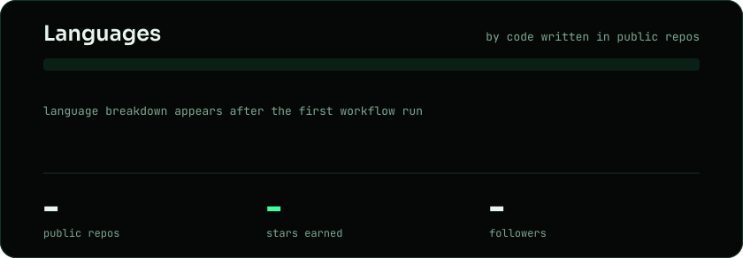
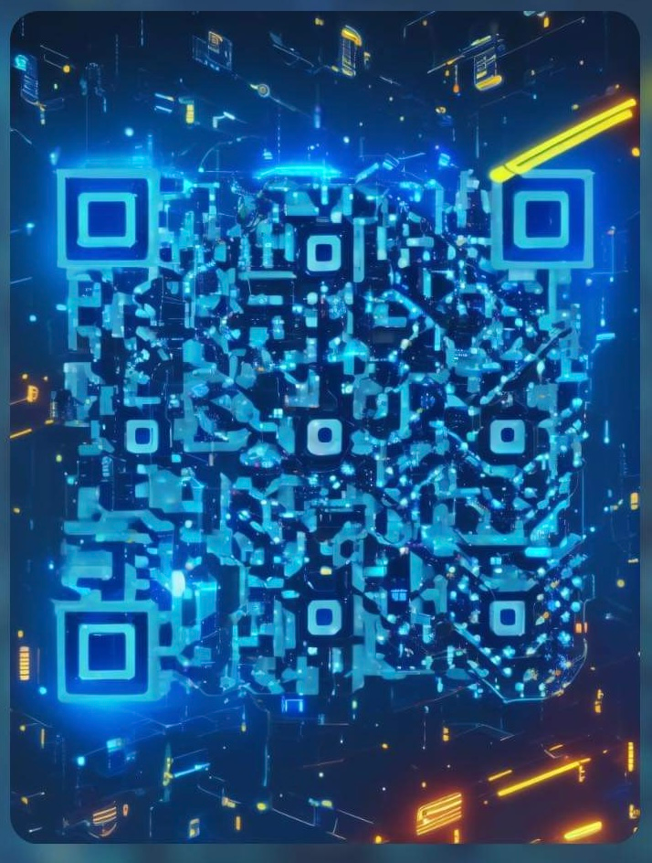

<p align="center">
  
</p>

<p align="center">
  <a href="https://git.io/typing-svg"></a>
</p>

<p align="center">
  <a href="https://fullstackthinker.com/"></a>
  <a href="https://www.linkedin.com/in/fullstackthinker26/"></a>
  <a href="https://www.upwork.com/freelancers/~01662ddccd4c2b19b1?mp_source=share"></a>
  <a href="https://www.facebook.com/thanhanthinker/"></a>
  <a href="mailto:devnguyenthanhan26@gmail.com"></a>
</p>

<p align="center">
  
</p>

## Meet thinker

Friends call me *thinker*. I think on paper before I type, then let the work loop: observe, reason, plan, act, reflect. Inside my head it looks like one orchestrator and a small team of specialist agents.

<p align="center">
  
</p>

## Four ways I work

<p align="center">
  
</p>

One engineer, four disciplines. Each one sharpens the others: systems thinking for models, optimization for games, and math for all of it.

## About me

```python
class Thinker:
    name = "Nguyen Thanh An"
    alias = "thinker"
    roles = [
        "software engineer",
        "AI engineer",
        "game developer",
        "AI & math researcher",
    ]
    site = "fullstackthinker.com"
    mindset = "always a student of the problem"

    def run(self) -> None:
        while True:
            problem = self.observe()          # find a problem worth solving
            insight = self.reason(problem)    # derive it on paper first
            plan = self.plan(insight)         # backend + model + game loop
            result = self.act(plan)           # write it, ship it
            self.reflect(result)              # what broke? what did I learn?
            # "I always try my best!"

    def delegate(self, goal: str):
        # my stand-in agent: plans, picks a tool, reads the result, remembers it
        return DemonAgent(tools=["api", "model", "game", "math"]).run(goal)
```

## Always learning

<p align="center">
  
</p>

What I am digging into right now:

<!-- EDIT: replace these rows with what you are really studying this month -->
<table>
  <tr>
    <td width="150"><b>Math</b></td>
    <td>Linear algebra, optimization and probability, worked by hand before any code.</td>
  </tr>
  <tr>
    <td><b>AI</b></td>
    <td>Transformers, fine-tuning and reinforcement learning, reimplemented to understand them.</td>
  </tr>
  <tr>
    <td><b>Agents</b></td>
    <td>Tool use, planning, memory and evals for agents that act on their own.</td>
  </tr>
  <tr>
    <td><b>Games</b></td>
    <td>Procedural generation and learning agents that live inside game worlds.</td>
  </tr>
  <tr>
    <td><b>Software</b></td>
    <td>Distributed systems, and backends designed to fail gracefully.</td>
  </tr>
</table>

<p align="center">
  
</p>

## Agents I like to build

<p align="center">
  
</p>

The little horned bot is my stand-in for an agent. It plans, picks a tool, reads what comes back and remembers it. Its four tools happen to be my four disciplines.

<p align="center">
  
</p>

## Notes from my math notebook

Three equations I keep coming back to, re-deriving and re-reading. Each one shows up in more than one of my four disciplines.

**Optimization.** How every model I train learns: step downhill on the loss.

$$\theta_{t+1} = \theta_t - \eta\,\nabla_\theta \mathcal{L}(\theta_t)$$

**Attention.** The core operation inside modern transformers.

$$\mathrm{Attention}(Q,K,V) = \mathrm{softmax}\!\left(\frac{QK^{\top}}{\sqrt{d_k}}\right)V$$

**Value of a state.** The idea behind learning agents and game AI.

$$V^{\pi}(s) = \mathbb{E}_{\pi}\!\left[\sum_{t=0}^{\infty} \gamma^{t}\, r_{t+1} \;\middle|\; s_0 = s\right]$$

## Tech stack

<table>
  <tr>
    <td width="190"><b>Software engineering</b></td>
    <td>
      
      
      
      
      
      
      
      
      
      
    </td>
  </tr>
  <tr>
    <td><b>AI engineering</b></td>
    <td>
      
      
      
      
      
    </td>
  </tr>
  <tr>
    <td><b>Game development</b></td>
    <td>
      
      
      
    </td>
  </tr>
  <tr>
    <td><b>AI and math research</b></td>
    <td>
      
      
      
      
      
    </td>
  </tr>
</table>

## Activity

<p align="center">
  
</p>

<p align="center">
  
</p>

## Support my work

<p align="center">
  
</p>

<p align="center">
  If my projects helped you, or you want to back what I build next, a coffee goes a long way.<br>
  Scan the QR code above to buy me one.
</p>

<p align="center">
  
</p>

<p align="center">
  <i>"I always try my best!"</i><br>
  <sub>Still training. Check back for the next epoch.</sub>
  <br><br>
  
</p>
